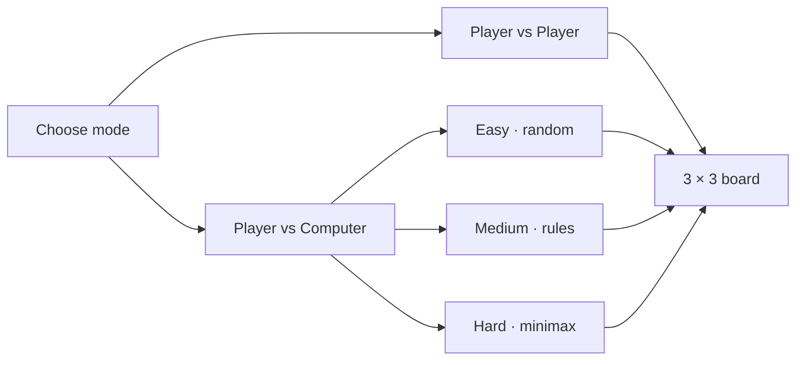

---

# 🎮 Tic Tac Toe Game in C

A fully interactive **Tic Tac Toe** game developed in **C**, featuring both **Player vs Player** and **Player vs Computer (AI)** gameplay modes. Includes multiple difficulty levels for the AI opponent, from basic random moves to an unbeatable AI using the **Minimax algorithm**.

---

## At a glance




## 🧠 AI Difficulty Levels

* **Easy** 🐢: Random move selection.
* **Medium** 🧠: Rule-based AI that can **block** player wins and **capitalize** on winning opportunities. Prioritizes center and corners.
* **Hard** 🔥: Implements the **Minimax algorithm**, making the AI unbeatable by evaluating all possible outcomes.

---

## 🕹️ Features

* ✅ Player vs Player mode.
* ✅ Player vs AI mode with difficulty selection.
* ✅ Clean 3x3 grid display with intuitive 1–9 input system.
* ✅ Turn management, win/draw detection, and input validation.
* ✅ Modular and readable code structure.

---

## 📸 Gameplay Preview

```
Tic Tac Toe
1. Play against another player
2. Play against the system (AI)
Enter your choice: 2
Choose AI difficulty:
1. Easy
2. Medium
3. Hard

 1 | 2 | 3
-----------
 4 | 5 | 6
-----------
 7 | 8 | 9
Player X, enter your move (1-9):
```

---

## 🛠️ How It Works

* The game loop tracks moves and alternates between players.
* AI logic is selected based on user input at the start.
* All AI strategies are implemented as separate functions:

  * `make_random_move()`
  * `make_medium_ai_move()`
  * `make_best_move()` (Minimax)

---

## 📂 File Structure

```
.
├── Tic-Tac-Toe.c   # Main source file
├── README.md       # Project documentation
```

---

## 🧪 Compilation & Execution

### On Linux / MacOS:

```bash
gcc Tic-Tac-Toe.c -o tic_tac_toe
./tic_tac_toe
```

### On Windows (using GCC via MinGW):

```bash
gcc Tic-Tac-Toe.c -o tic_tac_toe.exe
tic_tac_toe.exe
```

---

## 📚 Concepts Used

* C Programming
* Algorithms (Minimax)
* Game AI logic
* Recursion
* Input validation and loop control
* Grid-based display formatting

---
